# Groove

A music studio for RISC OS 5: drag loops into a song, play instruments from
the computer keyboard, draw beats in a step grid and notes in a piano roll,
record what you play, and export a WAV. Groove's own instruments and drums
are synthesised as they play, so there are no sample libraries to load and
songs are small text files. With
[!SoftMIDI](https://github.com/adyoull/riscos-softmidi) installed, any track
can also use a SoundFont's 128 General MIDI instruments and drum kits.

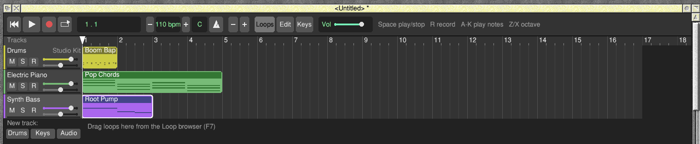

**Status: 0.2.3, an early version.** Tested on a Raspberry Pi 4 with RISC OS
5.31, and in RISC OS 5.31-5 under emulation on Linux.

## What it does

- **Loops**: 18 ready-made loops (drums, bass, keys and lead), played in
  your song's key. Drag them into the song and stretch them.
- **Drums**: a step grid of eight drums and sixteen steps a bar, with accents.
- **Notes**: a piano roll. Select several notes to move, copy, transpose or
  make louder together.
- **Musical typing**: play the computer keyboard like a piano, chords too,
  or a MIDI keyboard, with velocity and the sustain pedal: through Pete
  Everett's MIDI Support (Groove is a driver you connect to), or a MIDI
  module's ports (Rick Murray and Dave Hinton's USBMIDI).
- **MIDI out**: any track can be played by a MIDI instrument instead (a
  keyboard or sound module on USB or a MIDI cable, or a software synth),
  through MIDI Support or a MIDI module's port, in time with the song;
  F10 steps through the MIDI out choices, shown in the window's title;
  F11 sends the selected track, Shift-F11 the whole song.
- **Recording**: a bar of count-in, then what you play goes into a region,
  tidied to the nearest sixteenth; or merged into the region already there.
- **Arranging**: move, stretch, split, copy and paste regions; up to 16
  tracks; rename, reorder and colour-coded tracks; Undo and Redo.
- **Mixing**: volume, pan, mute and solo per track, a master volume, reverb
  and a limiter.
- **Any time signature**, changing part-way through a song if you like.
- **Files**: songs, WAV export, MIDI import and export, WAV import, and
  **Maestro music**: Groove plays RISC OS Maestro files the way Maestro
  does (clefs, key signatures, accidentals to the end of the bar, ties,
  dots, each channel's volume and stereo position, tempo and time
  signatures).
- **SoundFont sounds** through !SoftMIDI: each track can use any of the 128
  General MIDI instruments or 8 drum kits; Groove's own sounds stand in
  when !SoftMIDI isn't there.
- **A User guide** with pictures, in `!Groove.Guide` (Menu on the icon bar
  icon > User guide).

## Screenshots

The step grid with Boom Bap, one of the drum loops (brighter squares are
accented hits):

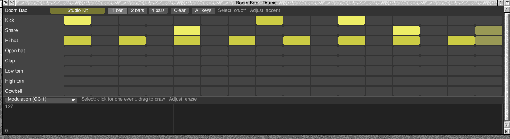

Notes selected in the piano roll, ready to move, copy, transpose or make
louder together:

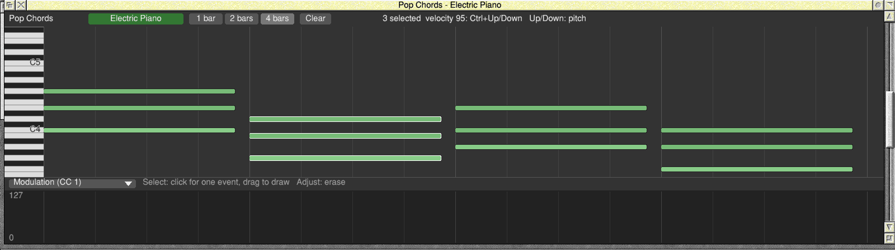

Gigue, one of the Maestro pieces that come with RISC OS, in Maestro and then
dropped on Groove: a track for each channel, in 6/8, at Maestro's tempo:

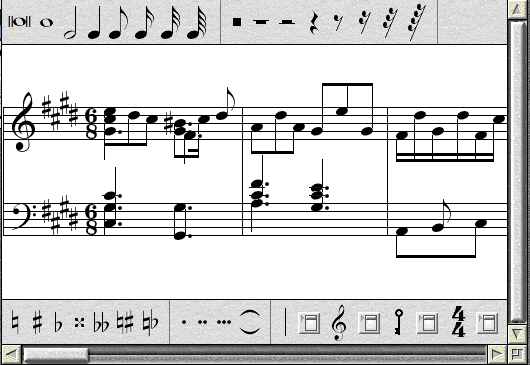

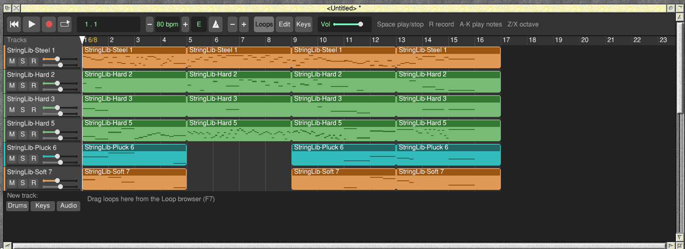

A MIDI file dropped on a new song, playing with SoundFont sounds:

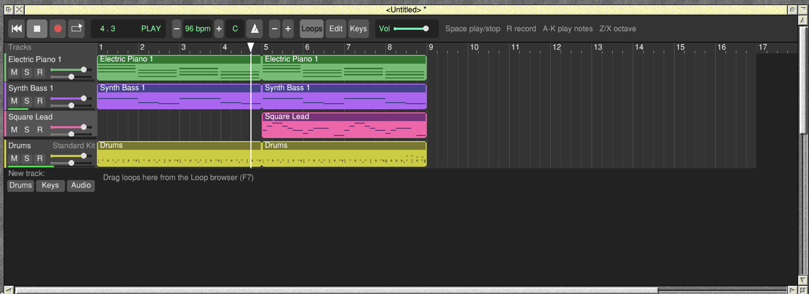

Pete Everett's MIDIKeyboard connected to Groove through MIDI Support,
recording a run up and a run down:

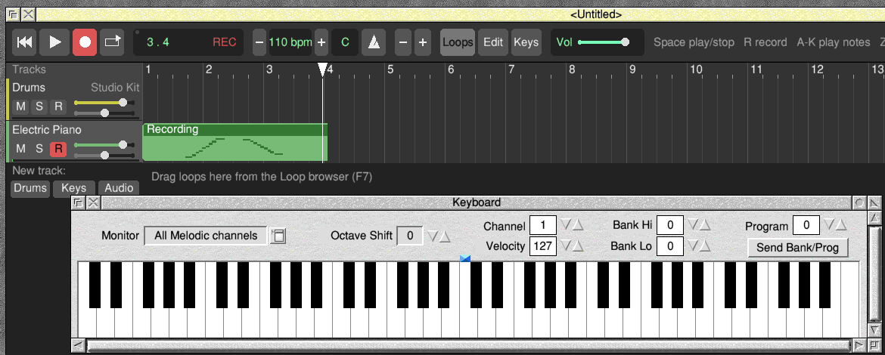

A track playing on MIDI out (here to Pete's MidiSynth), and the MIDI out
menu:

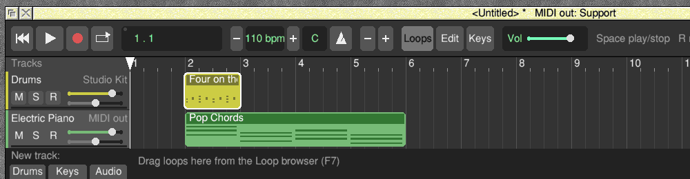

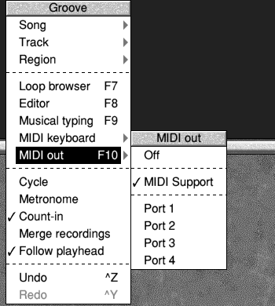

Choosing a SoundFont instrument, and playing a chord from the computer
keyboard:

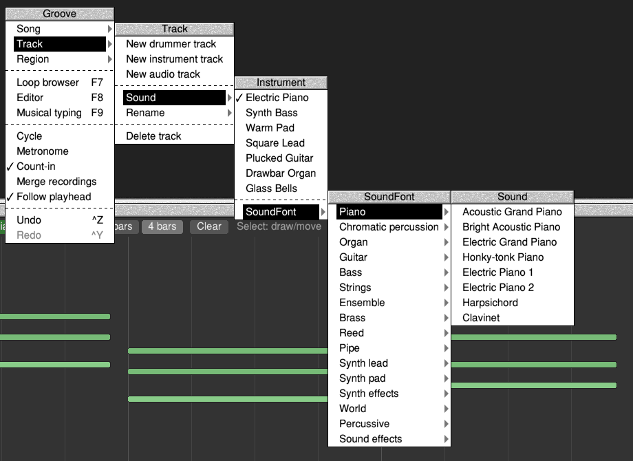

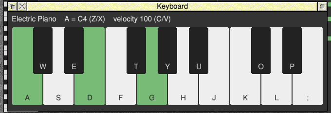

## Installing

1. Download `Groove-0.2.3.zip` from the release page and unzip it with SparkFS
   or PackMan's unzip, so the files keep their RISC OS file types.
2. Copy `!Groove` to wherever you keep your applications.
3. For SoundFont sounds, install **SoftMIDI** from PackMan, and open the
   directory it's in once so the Filer sees it.

Groove needs RISC OS 5 on an ARMv7 machine with VFP (a Raspberry Pi 2 or
later), **SharedUnixLibrary** 1.16 or later and **ARMEABISupport** (both
from PackMan); SharedSound comes with RISC OS 5. Groove doesn't include
SoftMIDI or a SoundFont.

## Building

With [riscos-crossdev](https://github.com/adyoull/riscos-crossdev) (v1.8.2 or
later) checked out beside this directory:

```sh
make RCD_DIR=../riscos-crossdev     # out/Groove.zip: unzip on RISC OS, run !Groove
make test                           # engine, interrupt handler, Wimp front end
make demo                           # out/demo.wav: the demo song, bounced
```

`make test` runs three sets of tests on Linux: the engine (song model,
sequencer, synths, files, MIDI and Maestro import, Undo, time signatures),
the SharedSound interrupt handler as ARM code under Unicorn, and the whole
Wimp front end against a fake RISC OS. It needs gcc with `-m32` support
(`gcc-13-multilib`), clang and llvm-objcopy, and `pip install unicorn`. The
SoundFont tests play TimGM6mb (GPL-2, used by the tests only, never
shipped), which `make soundfont` fetches from Ubuntu's package and checks by
sha256. Set `MAESTRO_DIR` to a directory holding RISC OS 5's Maestro
examples (`HardDisc4.Documents.Music.Maestro`, as `Name,af1`) and the tests
import all eight too.

## How it fits together

| Path | What |
|---|---|
| `engine/` | The portable engine: song model, sequencer, synths, drums, mixer, loops, files. No RISC OS calls. `gm.c` plays SoundFont sounds through libmidisynth; `midifile.c` imports and exports MIDI files; `maestro.c` imports Maestro music; `place.c` cuts imported notes into regions; `history.c` is Undo. |
| `riscos/` | The Wimp front end, drawing, and the sound path: the engine renders on null events into a ring buffer in the RMA, and a small SharedSound handler (`handler.s`) copies it out. |
| `third_party/softmidi/` | SoftMIDI's libmidisynth 0.5.0, unmodified (MIT). |
| `app/` | `!Run`, `!Boot`, `!Help`, the icon PNGs (made into `!Sprites` by `png2sprite.py`) and `Licences/`. |
| `docs/guide/` | The User guide, shipped in `!Groove.Guide`. |
| `host/` | The Linux tests and the fake RISC OS they run against. |

SoundFont details: one SoundFont serves every track. Instrument tracks take
MIDI channels in order, skipping channel 10, which all drum tracks share;
a 16th instrument track gets a second synth, loaded from the same SoundFont
only when a song needs it. The SoundFont goes through Groove's mixer, so
Export as WAV includes it.

## About this project

I've used AI to help with this. The code, build scripts and documentation
were written with Anthropic's Claude as a coding assistant.

## Licence

Groove is MIT licensed: see [LICENSE](LICENSE).

`!Groove.Licences` holds Groove's licence and the notices for what is linked
into `!RunImage`: libmidisynth and TinySoundFont (MIT), stb_vorbis (MIT or
public domain), and UnixLib (GCCSDK's C library; parts of it are under the
LGPL, and as it is linked statically, this source is what lets you rebuild
Groove against a changed UnixLib).
